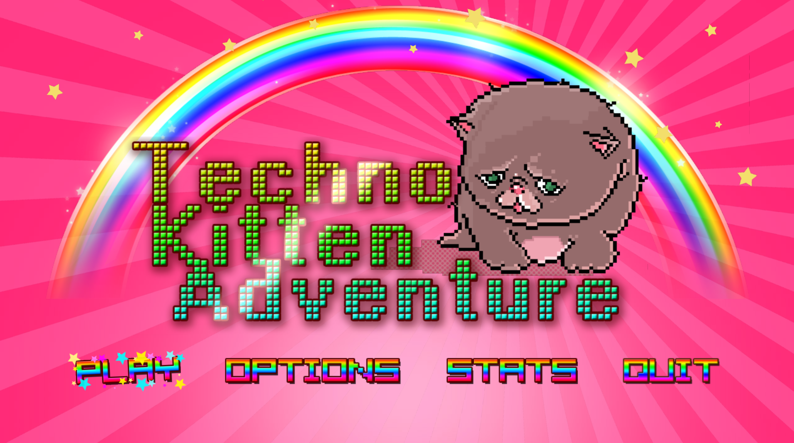
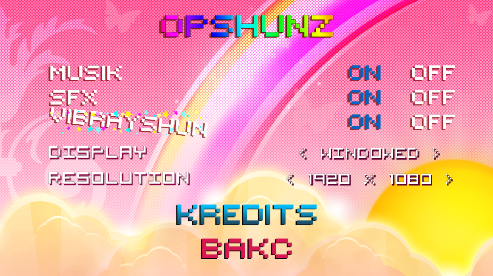
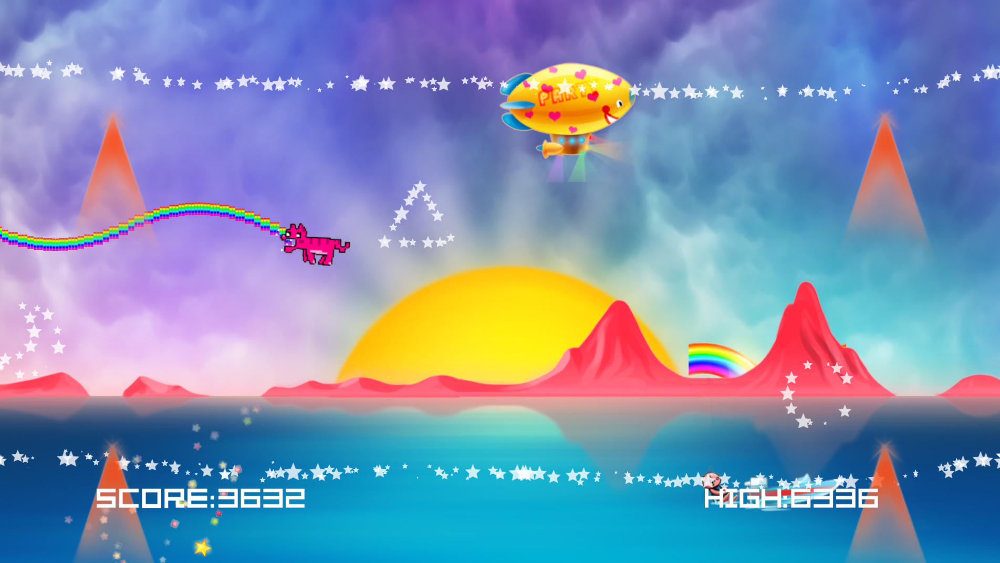
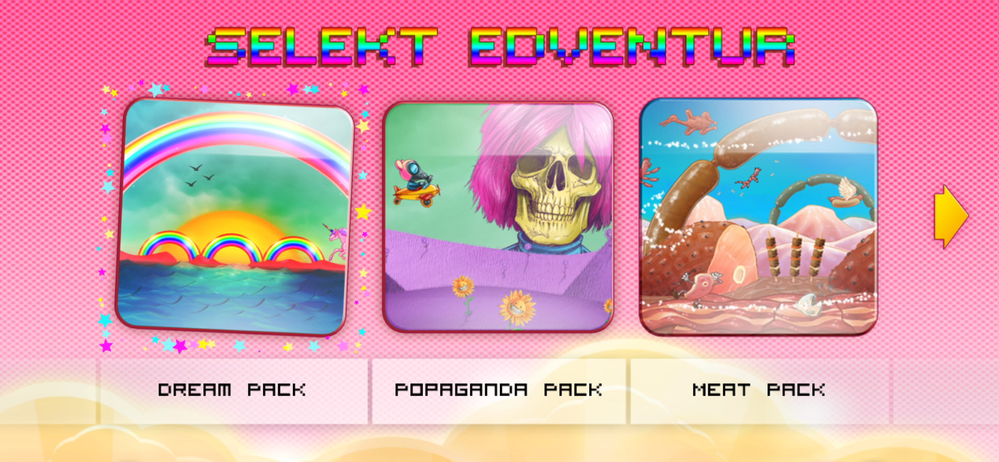
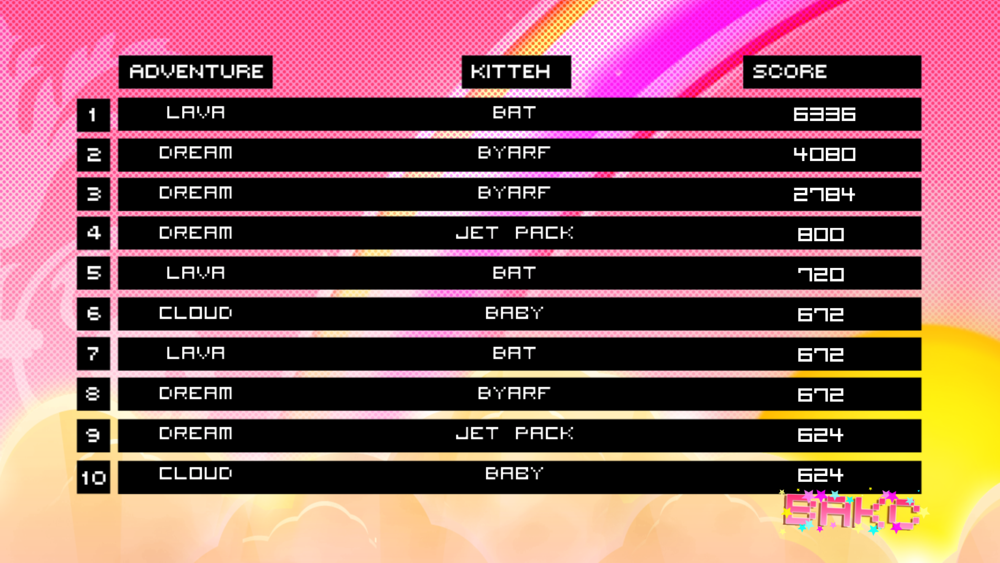

# Techno Kitten Adventure XBLA PC Recomp

An unofficial Windows PC port of **Techno Kitten Adventure!**, built with .NET 8 and MonoGame. Enjoy the original XBLA Indie game with mouse navigation, PC display options and portable saves.

> **You'll need your own supported Xbox 360 game package.** Setup checks your file and prepares the game on your PC. The player download contains no original game program or assets.

If you'd like to support future projects, you can leave an optional [Ko-fi tip](https://ko-fi.com/caiuscodes).

[](https://ko-fi.com/caiuscodes)



## Requirements

- Windows x64 and a Direct3D 11-capable graphics card. Windows 11 has been tested.
- Your own supported Techno Kitten Adventure! Xbox 360 package.
- A short writable folder for the portable game. No separate .NET installation is needed.

<details>
<summary>Which game package is supported?</summary>

Setup currently accepts one verified **83,353,600-byte LIVE package**, with header title ID `584E07D2` and this SHA-256:

```text
A472E517EF37A35A5C956C6ED558FE918F8D4E0C775995188CC17671FBB50EE5
```

Other revisions, repacked packages, loose extracted files and separate DLC packages are not supported. Setup rejects unsupported files without replacing an installed game.

</details>

## Install and play

Download **[Techno-Kitten-Adventure-XBLA-PC-Recomp-v0.9.0.zip](https://github.com/CaiusCodes/Techno-Kitten-Adventure-XBLA-PC-Recomp/releases/download/v0.9.0/Techno-Kitten-Adventure-XBLA-PC-Recomp-v0.9.0.zip)** from Releases.

1. Extract the complete **Techno Kitten Adventure** folder to a short, writable location.
2. Open **Techno Kitten Adventure.exe**. Put your package beside it or in **Game Package/** and setup will find it. One compatible package imports automatically; if several are found, choose one.
3. Otherwise, use **Browse Package**, or drop your package or its containing folder onto the window.
4. When setup says **Ready to play**, choose **Play**. Importing never launches the game automatically.

The optional **Start in fullscreen** and **Create desktop shortcut** boxes are unchecked by default and take effect when you click Play. Existing settings and shortcuts are preserved.

Next time, open the same **Techno Kitten Adventure.exe** and the game starts straight away. The original package is no longer needed. Use `--setup` to reopen the setup window manually.

Runtime files and imported data stay inside `resources/`; saves and display settings live in `resources/data/userdata/`. Move or back up the whole folder to keep everything together. Setup never changes your package. Reimport preserves your saves and keeps previous imported data as a backup. Recognised older `Game/` or `runtime/` installations can be copied across automatically while retaining their originals. Please don't share `resources/data/`, since it contains material from your game copy.

### Why is the download larger than a small importer?

The portable download includes the .NET 8 runtimes, MonoGame and setup conversion tools as ordinary files under `resources/`. No separate .NET installation is needed. A small importer may rely on prerequisites already installed on the PC; this release carries them with it. The ZIP contains no game assets. See the [portable launcher notes](docs/PORTABLE-LAUNCHER.md) for the layout, build commands and test coverage.
## Features

- Mouse navigation in menus, including clickable display options and level-select arrows.
- Keyboard controls alongside the original gamepad controls.
- Windowed or borderless fullscreen at 720p, 1080p, 1440p or 4K, with the original 16:9 proportions preserved.
- 2x internal rendering by default, independent of output size; fixed 60 Hz game updates and VSync off by default.
- Portable saves and display settings, plus a small build label on the title screen.
- Controller Select/Back prompts and flight instructions shown only while a gamepad is connected.



## Controls

| Input | Action |
| --- | --- |
| Arrows / WASD | Navigate menus |
| Space | Select; hold to fly up, release to descend |
| Enter | Start in menus |
| Esc | Back in menus; pause during play |
| S | Original Start / pause shortcut |
| B | Back / resume |
| Left click | Advance from Press Start; select in menus |
| Right click | Back in menus |

Move the mouse over menu items to highlight them. The cursor appears on the title screen and in menus, including pause, and hides during active play.

## Known limitations

Microsoft Defender found no threats in the release folder and ZIP on 14 October 2026. The launcher is unsigned, so Windows may still show a SmartScreen warning. One scan cannot guarantee acceptance by every antivirus; see the [scan details](docs/SECURITY-CHECK.md).

- Only the package listed above is supported.
- Deeply nested installation paths can stop Windows from launching the conversion tool.
- More testing is welcome on different GPUs, Windows versions, physical controllers and longer sessions.
- Setup preserves saves during reinstall, but the game's own save writes can still be interrupted by a crash.

Found a problem? Please [open an issue](https://github.com/CaiusCodes/Techno-Kitten-Adventure-XBLA-PC-Recomp/issues) with your build version, Windows version, GPU, input device and the steps to reproduce it. Check `resources/data/logs/` for personal paths before sharing excerpts. Please don't attach game packages, converted assets or saves.

## Screenshots




Game artwork in these captures remains the property of its owners; see the [screenshot notice](docs/screenshots/NOTICE.md).

## For developers

Despite the established repository name, this is a **managed .NET / MonoGame PC port**, not a ReXGlue or static PowerPC recompilation. Setup retargets the original XNA program and converts assets locally. Its patches check the original program's hash and exact method signatures. XenosRecomp handles shader translation, not the game's CPU code.

See the [build instructions](docs/BUILD-V1.md) for pinned dependencies and commands, the [technical handoff](docs/V1.md) for implementation details, and [release notes](RELEASE_NOTES.md) for changes. `VERSION` controls release numbering. Build and packaging tools live in `tools/`; generated game files stay private.

## Licence and credits

Original port code and the new cat/banner artwork use the [MIT licence](LICENSE). .NET, MonoGame, Mono.Cecil, SharpDX, XenosRecomp and their dependencies keep their own licences; see [third-party notices](THIRD_PARTY.md).

Techno Kitten Adventure!, Xbox and Xbox 360 belong to their respective owners. The port's licence grants no rights to the original game, its assets or trademarks. This is an unofficial fan project with no affiliation or endorsement.
